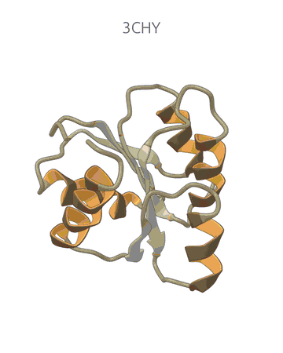
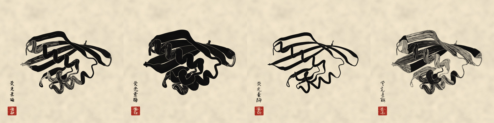

# molart

**Website: https://martin-steinegger.github.io/molart/**

Artist-inspired renderings of real protein, DNA and RNA structures, in the browser.



molart loads a PDB or mmCIF file, draws the usual cartoon, and then redraws the same structure in 21 styles, plus Shufa (Chinese calligraphy) in this fork.

## Inspired by great artists

Egon Schiele, Pablo Picasso, Gustav Klimt, Vincent van Gogh, Salvador Dalí, Claude Monet,
Katsushika Hokusai, Georgia O'Keeffe, Andy Warhol, Jackson Pollock, Wassily Kandinsky,
Henri Matisse, Piet Mondrian and Leonardo da Vinci, and the sumi-e ink tradition.

The styles are a tribute, not the artists' work: each is our own reimagination, drawn by code.

Further styles: glass, frosted, cartoon, surface and ASCII.

## Shufa 書法 (this fork)

Chinese calligraphy: the chain is one brush line written in a single breath. Strands are pressed, broad strokes
that lift to a point, helices are written at middle weight, loops are the gossamer threads between strokes. The
brush is dipped, writes until it runs dry and is dipped again, so the ink goes from wet black to flying white
along the chain; where strokes cross, a hair of paper is left. The picture is mounted on xuan paper with an
inscription column and a cinnabar seal.



It comes in four hands, chosen with the **Hand** selector or by style id:

| Hand | Style id | Line | Lettering |
|---|---|---|---|
| Running 行草 | `shufa` | middle weight, some flying white | Zhi Mang Xing |
| Thick 顏楷 | `shufa-yan` | full, heavy, wet | Ma Shan Zheng |
| Slender 瘦金 | `shufa-shoujin` | thin, taut, even black | Long Cang |
| Dry brush 狂草 | `shufa-kuangcao` | broad against hair-fine, frayed into flying white | Liu Jian Mao Cao |

```sh
node cli/molart.mjs render public/samples/1UBQ.cif --style shufa-kuangcao --seal 泛素 --inscription 一笔书 --output ubq.png
node cli/molart.mjs render public/samples/1UBQ.cif --style shufa --plain --output ubq-plain.png   # bare picture on white
```

The seal takes one to four characters (default 蛋白, "protein"), the inscription up to sixteen. The four faces
cover simplified characters; others fall back to a system face.

## Features

- **Coordinates never change.** Every effect lives in display geometry and shaders.
- **Science | Art.** Science mode keeps the ribbon geometry; art mode (opt-in, labelled) lets a
  style reshape the drawn ribbon.
- **Per chain.** Each chain can have its own style and mode.
- **DNA and RNA.** Nucleic acids are drawn as a backbone band through the phosphates with a slab
  for every base, alone or next to protein. Art mode does not reshape them.
- **Local.** Files you open stay in your browser. Fetching by PDB ID is an explicit button and
  goes to files.rcsb.org.
- **Export.** White-background PNG up to 4K.

## Run

Requires Node 20 or newer.

```sh
npm install
npm run dev        # http://localhost:5173
npm run build      # static site in dist/
```

## Command line

Renders with the same code as the app, in headless Chromium
(`npx playwright-core install chromium`).

```sh
node cli/molart.mjs render public/samples/1TIM.cif --style klimt --width 2400 --height 2400 --output klimt.png
node cli/molart.mjs gallery public/samples/1TIM.cif --size 2048 --output-dir outputs/
node cli/molart.mjs styles
```


## Credits

- molart was inspired by Sergey Ovchinnikov's protein structure visualization in
  [LocalFold](https://github.com/sokrypton/localfold).
- The Scientific style follows Jane Richardson's hand-drawn ribbon diagrams (1981).
- The Glass style is inspired by a protein rendering in a
  [LinkedIn post](https://www.linkedin.com/feed/update/urn:li:activity:7526936072279212032/) by Latent Labs.
- The ASCII style is inspired by [ascii-fold](https://github.com/mitsenkov/ascii-fold) by
  Maxim Tsenkov.
- The Shufa lettering uses Zhi Mang Xing, Ma Shan Zheng, Long Cang and Liu Jian Mao Cao from
  [Google Fonts](https://github.com/google/fonts), SIL Open Font License 1.1 (licences in `public/fonts/`).
- Sample structures in `public/samples/` (1TIM, 3CHY, 1UBQ, 4HHB, 1BNA, 1EHZ, 1AAY) are unmodified downloads from
  the [RCSB PDB](https://www.rcsb.org) (CC0 1.0).

## License

MIT, see [LICENSE](LICENSE).
